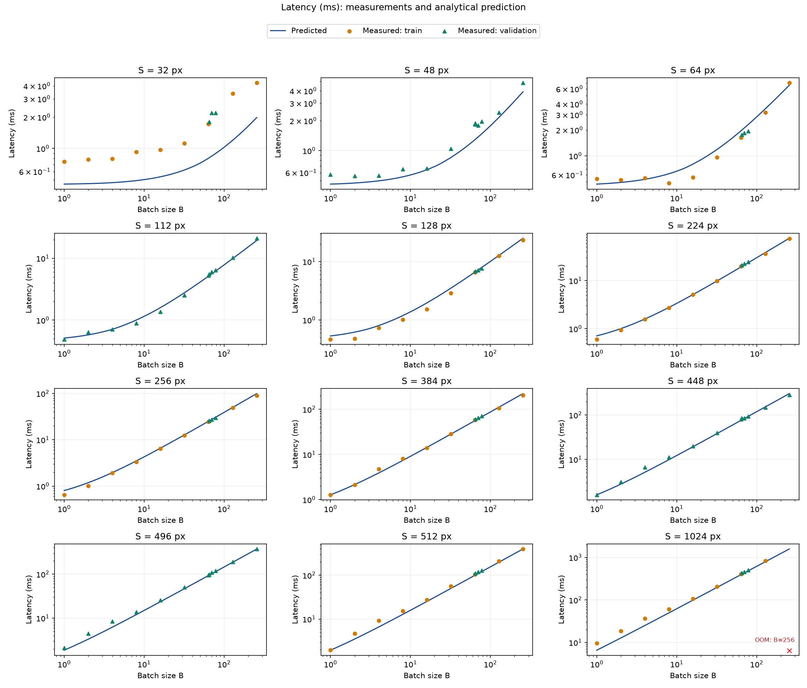
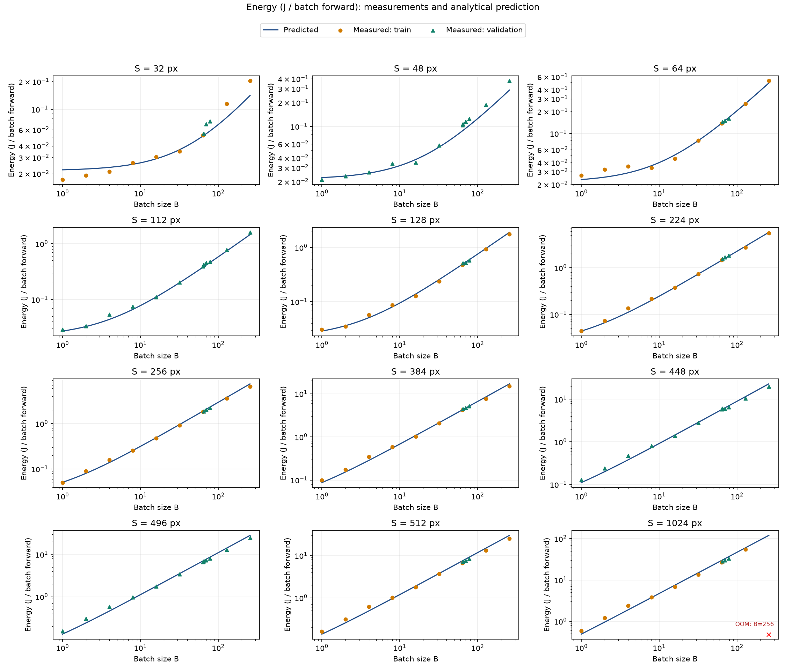
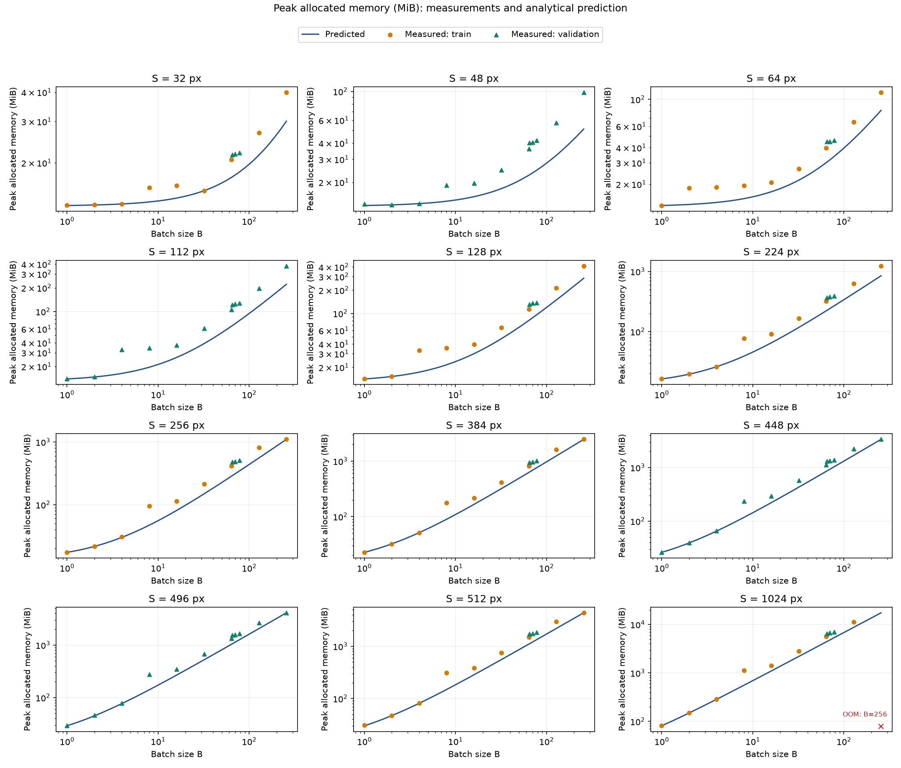

# Homework 1: CNN, measurement grid, and GPU energy

## Setup and checks

Create venv with `uv venv`:

```sh
uv sync
uv run python measure.py --dry-run
```

To reproduce the submitted analysis without a GPU or new measurements:

```sh
uv sync
uv run python calibrate.py
uv run python plot_results.py
```

## Run on an NVIDIA CUDA GPU
For a Colab GPU environment (PyTorch 2.11.0+cu130 on T4) run:

```sh
python measure.py --seed 42 --energy-seconds 5 --output results/measurements.csv
```

Energy measurement is enabled by default. `--energy-seconds 10` increases the measurement window; 
`--no-energy` keeps only latency and memory measurements.
The grid has 144 configurations, so 5-second energy windows add roughly 12
minutes if all configurations succeed, in addition to warmup and timing runs.

The runner generates one random FP32 input tensor at a time and reuses it for
5 warmups and 20 measured forwards under `torch.inference_mode()`. cuDNN
benchmarking and TF32 are disabled as prescribed in section 7. The CSV records
`S,B,status,latency_seconds,memory_bytes,energy_joules,energy_status,energy_error,energy_repeats,energy_duration_seconds,is_validation`
and is flushed after every configuration. An existing output file is overwritten.

Latency is median synchronized wall-clock time, excluding input generation.
Memory is the largest peak allocated CUDA memory observed across the measured
forwards, including resident model and input, with peak statistics reset before
each forward. Outputs are released between calls. CUDA out-of-memory failures
during input creation, warmup, or measurement produce `status=OOM`, blank metric
fields, and execution continues to the next configuration after cleanup.

## Energy protocol

`energy.py` uses NVIDIA NVML's cumulative GPU energy counter, returned in mJ.
It selects the same physical GPU as PyTorch by UUID, including when
`CUDA_VISIBLE_DEVICES` changes device numbering. After warmup and the separate
latency/memory measurements, it reuses the existing input for synchronized
forwards until at least `--energy-seconds` has elapsed. Outputs are released
between forwards. The counter is read before and after this series:

```text
energy_joules = (counter_after_mJ - counter_before_mJ) / (1000 * energy_repeats)
```

This is average energy for one forward of the **whole batch**, not per image.
Divide by `B` to obtain energy per image. It includes the whole GPU's baseline
consumption and the gaps between synchronized launches; idle power is not
subtracted. Input generation, warmup, and garbage collection are outside the
energy interval. Keep other workloads off that GPU. Repeat full measurements
with distinct output paths to assess variability; a longer window reduces
boundary/sensor-update effects but does not eliminate sensor uncertainty.
Latency remains the median of the original timing runs; energy is an average
over a separate series. Its duration and forward count are retained in the CSV.

`energy_status` is `OK`, `DISABLED` (`--no-energy`), `UNAVAILABLE` (initialization,
device matching, or counter support failed), `ERROR` (a counter read failed or
the counter stayed constant/decreased), or `OOM`. Failed energy readings stay
blank, with a reason in `energy_error`; successful latency/memory values are
retained for sensor failures. OOM at any stage, including the energy series,
marks the entire configuration `OOM` and clears measurement fields. NVML is
closed after the grid, including on interruption. No power-sampling fallback
is implemented: an unsupported energy counter is reported explicitly.

For programmatic use, pass an open `NvmlEnergyCounter` to `run_grid` or
`measure_configuration` as `energy_counter`; without it those functions only
measure latency and memory. The command-line entry point opens it automatically.

Reference: [NVIDIA NVML device queries](https://docs.nvidia.com/deploy/nvml-api/latest/api/group__nvmlDeviceQueries.html).

## Calibrate latency and energy

```sh
uv pip install --python .venv/bin/python scipy matplotlib
.venv/bin/python calibrate.py
.venv/bin/python plot_results.py
```

Energy is read from the canonical CSV by default. To reconstruct from the
original log, pass `--measurements measurements.csv --energy-log joules.txt`.
Energy log entries are joined by `(S, B)`. Only the 71 successful training
points are used for fitting; 72 validation points remain held out. The script
writes `results/theta.json` and `results/predictions.csv`. For a measurement CSV
that already includes energy, pass `--energy-log -`. Use `--output-dir` to
preserve previous calibration outputs.

Provided measurements: Tesla T4, CUDA 13.0, PyTorch 2.11.0+cu130.
Validation MAPE is 11.11% for latency and 8.09% for energy. The energy FLOP and
byte coefficients are poorly identifiable because the predictors are nearly
proportional; the fitted zero FLOP coefficient is not a physical energy claim.
See FORMULAS.md for the full coefficient table and error limitations.

Verified locally with Python 3.12.11, PyTorch 2.14.1, NumPy 2.5.4, plus nvidia-ml-py 13.615.71 installed using uv in the project `.venv`.

## Results and discussion

The analytical model counts one multiply-accumulate as two FLOPs, includes
linear biases and global-average arithmetic, and excludes ReLU/MaxPool
comparisons. Its logical byte count includes input/weight reads and output
writes, including in-place ReLU traffic and assumed int64 pooling indices.

| Metric | Training MAPE | Held-out MAPE | Held-out maximum error |
|---|---:|---:|---:|
| Latency | 15.48% | 11.11% | 61.64% |
| Energy | 9.40% | 8.09% | 23.71% |
| Memory baseline | 18.60% | 26.89% | 50.52% |

There are 71 successful training configurations and 72 held-out ones; OOM is
excluded from numeric fitting and error metrics. Latency uses a per-layer
roofline with three effective parameters: launch overhead 23.64 microseconds
per modeled operation, compute rate 5.94 TFLOP/s, and bandwidth 86.36 GB/s.
At small inputs, fixed launch and synchronization overhead dominates. As
inputs grow, logical traffic and arithmetic matter more. The maximum of
compute time and memory time is taken separately for each operation.

Energy is whole-GPU energy per batched forward, including baseline consumption
and synchronized-launch gaps. The fitted expression is
`E = 0.01664579135 + 1.1739295961e-9 * D` joules. Nonnegative fitting sets the
FLOP coefficient to zero because F and D are nearly proportional across this
network's grid. This is an identifiability problem, not evidence that compute
uses no energy. Separate energy/latency series and rounded log values also
limit interpretation; their ratio is not used as a power measurement. Repeat
runs would be needed to quantify measurement variance, which is unavailable
in the supplied table.

Memory uses the previously derived baseline `13729792 + 68*B*S*S` bytes.
The constant assumes rounded resident parameter allocations plus persistent
library buffers for the measured software configuration; the variable part
counts the input and live tensors at the pooling stage.
`results/validation_summary.json` reports memory errors and the baseline at
each observed OOM. The OOM at S=1024, B=256 has a baseline above 17 GiB, already
exceeding a 16 GiB capacity. This explains that failure without guaranteeing
that every smaller baseline will fit: CUDA context, allocator reservation,
fragmentation and other allocations also consume device capacity but are not
all included in `max_memory_allocated`.




